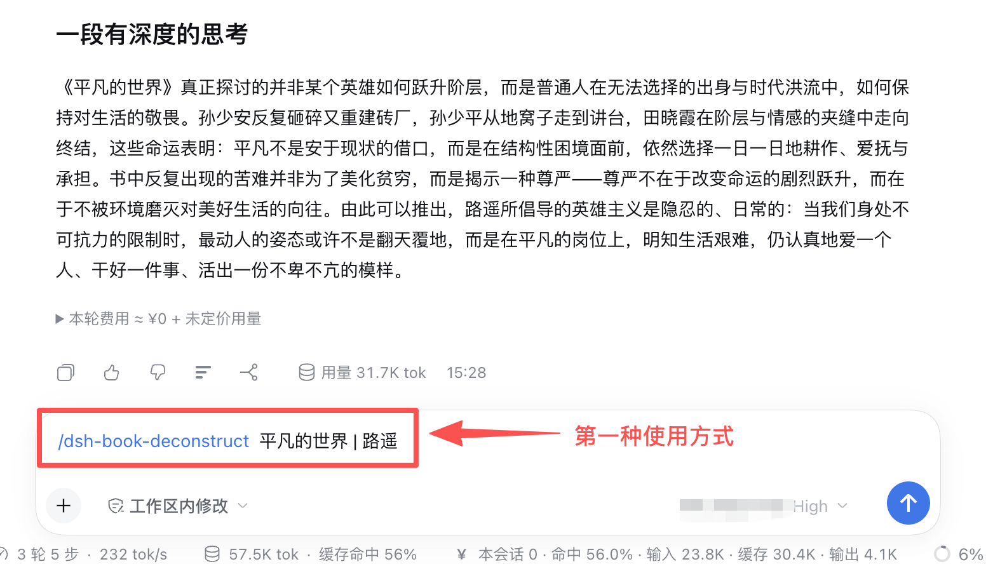

# dsh-book-deconstruct

DeepSeek Harness **Host 插件**：装进 profile 后会出现在插件列表，**任意会话**都可用：
好用的书籍拆解工具  

- 斜杠命令：`/dsh-book-deconstruct 书名 | 作者`  或者   `帮我解读书籍 xxx  作者xxx` 
- 工具：`dsh-book-deconstruct`（智能体在对话里调用）

## 安装

从 npm（推荐）：

```sh
dsh plugin --profile desktop add dsh-book-deconstruct
```

从本地目录（开发）：

```sh
dsh plugin --profile desktop add /path/to/dsh-book-deconstruct
```

从 GitHub：

```sh
dsh plugin --profile desktop add github:OWNER/dsh-book-deconstruct
```

装完后**完全退出并重新打开** DeepSeek Harness。

## 用法

任意的会话均可：

```text
/dsh-book-deconstruct 思考，快与慢 | 丹尼尔·卡尼曼
```

输出两段：

1. **故事情节** — 讲清整本书（不是一句话短评，也不灌水）
2. **一段有深度的思考** — 只写一整段


也支持：

```text
/dsh-book-deconstruct 《思考，快与慢》丹尼尔·卡尼曼
```

或直接说：「帮我解读《思考，快与慢》，作者丹尼尔·卡尼曼」。

输出只有两部分：把整本书讲透 + 最后一段有深度的思想。不编造不确定的事实、引文、页码。

## 配置（可选）

在 profile 的 `cordis.patch.yml` 按行 id `dsh-book-deconstruct` 覆盖：

```yaml
- id: dsh-book-deconstruct
  name: dsh-book-deconstruct
  config:
    provider: ''   # 与 model 成对；空则用默认模型
    model: ''
    temperature: 0.5
    maxTokens: 8000
```
## 使用方式

### 第一种使用方式



### 第二种使用方式


